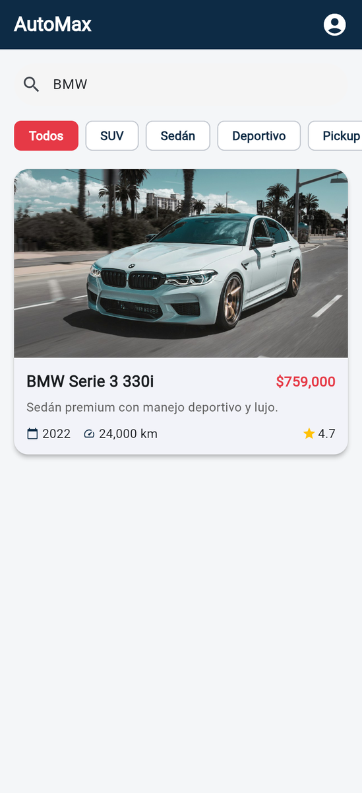
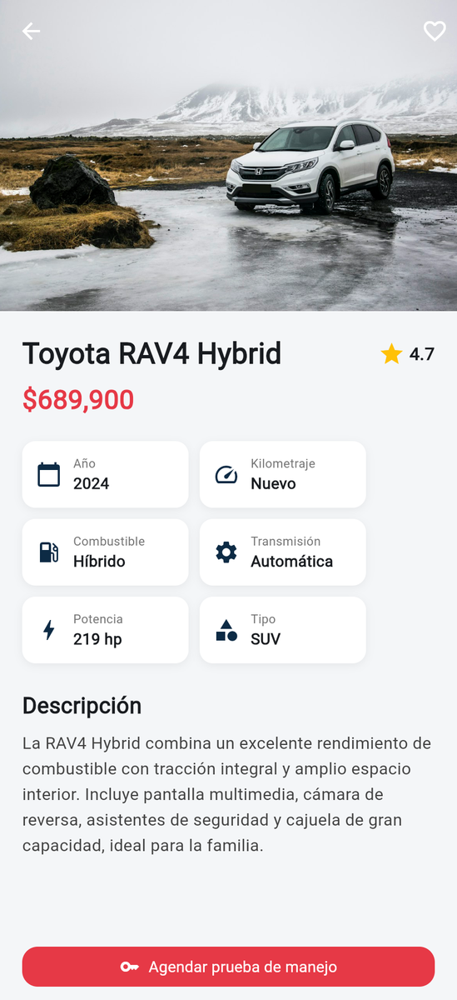
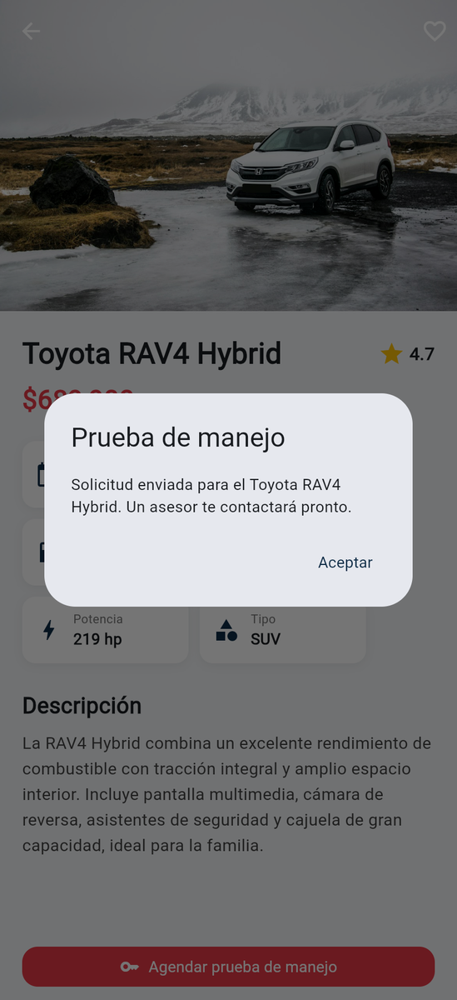

# AutoMax · Venta de carros

App móvil completa en **Flutter** para una agencia de autos: catálogo con fotos, filtros por categoría, búsqueda, pantalla de detalle con ficha técnica y solicitud de prueba de manejo.

| | |
|---|---|
| **Alumno** | Cristopher Gerardo Villanueva Ramírez |
| **Materia** | Desarrollo de Aplicaciones Móviles |
| **Tarea** | 7 · Desarrollo de app móvil completa en Flutter |
| **Código** | [`VentadeCarros/`](VentadeCarros/) |

## Capturas de pantalla

<table>
  <tr><td align="center"><br><sub>Splash</sub></td><td align="center"><br><sub>Catálogo</sub></td><td align="center"><br><sub>Filtro por categoría (SUV)</sub></td></tr>
  <tr><td align="center"><br><sub>Búsqueda</sub></td><td align="center"><br><sub>Detalle del auto</sub></td><td align="center"><br><sub>Agendar prueba de manejo</sub></td></tr>
</table>

## Funcionalidades

- **Splash screen** animado que pasa al catálogo a los 3 segundos.
- **Catálogo** de autos en tarjetas con foto, precio, año, kilometraje y calificación.
- **Filtros** por categoría: Todos, SUV, Sedán, Deportivo y Pickup.
- **Búsqueda** por marca o modelo.
- **Detalle** con ficha técnica (año, kilometraje, combustible, transmisión, potencia, tipo) y descripción.
- Botón **Agendar prueba de manejo** con diálogo de confirmación.
- Si una foto no carga, se muestra un ícono de respaldo.

## Estructura

```
VentadeCarros/lib/
├── main.dart
├── data/cars_data.dart          # datos de ejemplo
├── models/car.dart
├── screens/  splash_screen · home_screen · detail_screen
└── widgets/  car_card · car_image · category_chips
```

## Cómo ejecutar

```bash
cd VentadeCarros
flutter pub get
flutter run
```
